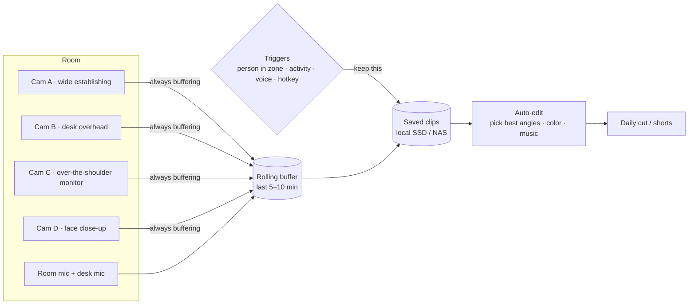

# recording-yourself-plan

A plan for a room that films your life like a movie: small, high-quality cameras placed around the
room, each locked on a specific shot (the desk, the bed, the window, your face), that **only record
when something worth keeping happens**, and hand you clean, cinematic footage you can cut into
content.

> Status: planning. Nothing built yet. Prices are rough mid-2026 numbers; check before buying.

---

## The idea in one picture



Cameras run all the time but **nothing is kept** unless a trigger fires. When it does, the system saves
the last few minutes plus whatever happens next, from every angle, so you never miss the start of a
moment.

---

## What "cinematic" needs (so the hardware choices make sense)

| Ingredient | Why it matters | How we get it |
| --- | --- | --- |
| **Locked compositions** | Real films use deliberate shots, not a security-camera view | Each camera has one job and one frame, set once |
| **Resolution headroom** | "Zoom in on the desk" without a blurry crop | Record 4K, deliver 1080p/vertical crops. Punch-in up to 2× stays sharp |
| **Good light** | The biggest quality jump for the least money | One soft key light, practical lamps in frame, warm/cool contrast |
| **Shallow focus on hero shots** | Separates you from the background | One "hero" camera with a larger sensor and a fast lens |
| **24 fps, 1/50 s shutter, LOG + LUT** | The film look and a consistent grade across cameras | Same settings and white balance on every camera |
| **Clean audio** | Bad audio ruins good video | A room mic plus a desk mic; record audio with every clip |

---

## Shot list (start with 3, grow to 5)

| Cam | Shot | Placement | Lens / camera |
| --- | --- | --- | --- |
| A | Wide establishing (whole room) | High corner, looking down | Wide (~100–120°) |
| B | Desk overhead (hands, keyboard, notebook) | Ceiling or arm mount above desk | Normal, 4K for punch-ins |
| C | Over-the-shoulder (screen + you) | Behind and above your chair | Normal |
| D | Face / reaction close-up (hero) | Beside monitor at eye level | Larger sensor, fast lens |
| E | Window / mood (B-roll) | Shelf facing the window | Any; timelapse mode |

The "zoom out / zoom in on the desk" ask is solved by **Cam B recording 4K and the editor cropping**
(digital punch-in), with an optional motorized PTZ camera later for real moves.

---

## Hardware options

### Cameras: three tiers

| Tier | Camera | Why | Rough cost each |
| --- | --- | --- | --- |
| **DIY / programmable** | Raspberry Pi 5 + **Camera Module 3** (wide or normal) | Tiny, 12 MP, autofocus, full control in code, records straight to SSD | ~$110–140 with Pi |
| | Raspberry Pi 5 + **HQ Camera** + C/CS-mount lens | Swappable real lenses → nicer bokeh and sharper image | ~$150–250 |
| | Raspberry Pi **AI Camera** (Sony IMX500) | Runs person detection *on the sensor*, perfect for triggers | ~$70 + Pi |
| **Plug-and-play** | AI PTZ webcams (OBSBOT Tiny / Tail series, Insta360 Link series) | 4K, auto-tracking, motorized pan/tilt/zoom, USB or network (NDI) | ~$200–500 |
| **Hero / cinematic** | Small mirrorless (Sony ZV-E10 II / FX30 class) + fast prime | Big sensor, real depth of field, LOG profiles | ~$700–1,800 + lens |
| | DJI Osmo Pocket-class gimbal camera | Tiny, stabilized, great image for handheld B-roll | ~$500 |

**Recommendation:** start DIY with Raspberry Pis (cheap, small, fully scriptable, and a great
build-in-public story), add one mirrorless hero camera for the face shot once the system works.

### The rest

| Part | Options | Notes |
| --- | --- | --- |
| Recording brain | Mac mini (M-series) or a mini PC; or each Pi records locally | One central box is easier for syncing angles |
| AI accelerator (optional) | Raspberry Pi AI Kit / AI HAT+ (Hailo) | Real-time person/pose detection without a big computer |
| Capture for mirrorless | Elgato Cam Link 4K or any HDMI→USB capture | Turns the hero camera into a feed the brain can buffer |
| Storage | 2–4 TB NVMe SSD in the brain, NAS later | See storage math below |
| Network | Wired Ethernet + PoE where possible | Wi-Fi drops frames with 4 cameras at 4K |
| Mounts | Magic arms, ceiling clamps, 3D-printed Pi cases | Hide cables; consistent angles matter more than gear |
| Light | 1 soft key (LED panel + softbox), 2–3 practical lamps, RGB accent | Smart plugs so lights can turn on with recording |
| Audio | Shotgun/room mic + desk mic into a USB interface | Or wireless lavs (DJI Mic class) for talking moments |
| Tally light | Small LED per camera | Shows when clips are being *saved* (privacy + vibe) |

---

## "Only record specific parts": how the triggers work

Everything streams into a **rolling buffer** (last 5–10 minutes in RAM or on SSD). A trigger turns a
buffer into a saved clip: the pre-roll, plus everything until the moment ends.

| Trigger | How it's detected | Example |
| --- | --- | --- |
| **Zone presence** | Person detection inside a drawn region (desk, couch) | You sit down to work → Cams B, C, D save |
| **Activity** | Pose / motion: typing, writing, standing up, playing an instrument | Hands on the keyboard for 2 minutes → "work session" clip |
| **Voice** | Talking detected on the mic, or a phrase ("clip that") | Explaining something out loud → face cam + audio |
| **Hotkey / button** | Keyboard shortcut, Stream Deck, or a physical button | You feel a moment coming → save last 5 min |
| **Schedule** | Time windows | Morning routine 7–8am, timelapse of the window at sunset |
| **"Interesting" score** | A vision model rates frames (new object on desk, big movement, a second person) | Unboxing, a friend comes over |

Rules live in one config file, for example:

```yaml
zones:
  desk:   { camera: B, polygon: [[0.2,0.3],[0.8,0.3],[0.8,0.9],[0.2,0.9]] }
  couch:  { camera: A, polygon: [[0.0,0.5],[0.4,0.5],[0.4,1.0],[0.0,1.0]] }
rules:
  - when: person_in(desk) for 60s
    save: [B, C, D]
    preroll: 30s
    until: zone_empty(desk) for 120s
  - when: voice_phrase("clip that")
    save: all
    preroll: 300s
quiet_hours: "00:30-07:00"   # never record while sleeping
```

---

## Software plan

| Piece | Choice | Why |
| --- | --- | --- |
| Camera capture | `rpicam-vid` / `libcamera` on each Pi, or FFmpeg | Hardware H.264/H.265 encode, low CPU |
| Transport | RTSP or SRT from each camera to the brain | Standard, works with every tool below |
| Buffer + triggers | **Frigate** (open-source NVR) to start; custom Python service later | Frigate already does zones, person detection and pre-roll clips |
| Detection | YOLO / pose models (on Hailo or the Pi AI Camera) | Person, hands, pose for "typing" or "writing" |
| Voice trigger | Small on-device speech model (Whisper-class) | "Clip that" without the cloud |
| Multicam sync | Timestamps from one clock (NTP/PTP) + audio sync | So the editor can cut between angles |
| Auto-edit | FFmpeg + `auto-editor` + an LLM picking the best moments and angles | Daily 60-second cut, plus shorts |
| Grade | One LUT per camera to match colors, then a shared "look" LUT | Same color across cheap and expensive cameras |
| Dashboard | Small web app: live views, clip timeline, star/delete | Review a day in two minutes |

---

## Storage math

| Format | Bitrate | Per camera-hour |
| --- | --- | --- |
| 4K H.265 (good) | ~25 Mbps | ~11 GB |
| 4K H.264 | ~45 Mbps | ~20 GB |
| 1080p H.265 | ~8 Mbps | ~3.5 GB |

Recording 4 cameras around the clock would be ~1 TB a day. **Triggered recording at roughly 2 hours of
kept footage a day is ~90 GB/day**, so a 4 TB SSD holds about six weeks before archiving.

---

## Privacy and safety (non-negotiable)

- **Everything stays local.** No cloud upload by default; clips leave the house only when you export them.
- **Consent.** Family and friends get a visible tally light and a "pause" button. Guests are asked;
  a guest present = don't save (a detected unknown face pauses saving).
- **No cameras** in bathrooms or anywhere someone changes clothes; quiet hours while you sleep.
- **Audio laws:** recording conversations you're not part of can be illegal; keep mics on your own
  zones and check your state's rules.
- **Physical kill switch** that cuts power to every camera, plus lens caps.
- **Secure the network:** cameras on their own VLAN, no default passwords, no ports open to the internet.

---

## Roadmap

| Phase | Goal | Hardware | Done when |
| --- | --- | --- | --- |
| 0 · Prototype (1 weekend) | Prove the buffer + trigger idea | Your phone or a webcam + laptop running Frigate | Sitting at the desk saves a clip with 30 s pre-roll |
| 1 · Two real angles | Desk overhead + wide | 2× Pi 5 + Camera Module 3, SSD, mounts | Two synced angles of a work session, automatically |
| 2 · Smart triggers | Activity + voice + hotkey | AI Camera or Hailo kit, desk mic | "Clip that" and "typing for 2 min" both work |
| 3 · Cinematic | Light + hero camera + grade | Key light, mirrorless + capture card, LUTs | A clip you'd post without editing the color |
| 4 · Auto-edit | Daily cut | Same box + auto-edit pipeline | A 60-second daily video is waiting each morning |
| 5 · Moves (optional) | Real zooms and slides | PTZ camera or motorized slider | Smooth push-in on the desk triggered by an event |

Rough budget: **Phase 0–1 ~$350**, through Phase 3 **~$1,500–2,500** depending on the hero camera.

---

## Open questions

- Which room layout and where can mounts go (renting vs. owning)?
- Mac mini as the brain, or keep everything on Pis?
- Vertical (shorts) or horizontal (YouTube) as the main output? It changes the framing.
- How much should the AI edit vs. you?

## Shopping list for Phase 0–1

- [ ] 2× Raspberry Pi 5 (8 GB) + official power supplies
- [ ] 2× Camera Module 3 (one Wide)
- [ ] 2× fast microSD or NVMe HAT + SSD
- [ ] 2× magic arms / ceiling clamp mounts
- [ ] 1× 2 TB NVMe SSD for the brain
- [ ] 1× soft LED key light
- [ ] Ethernet cables (or a small PoE switch + PoE HATs)
